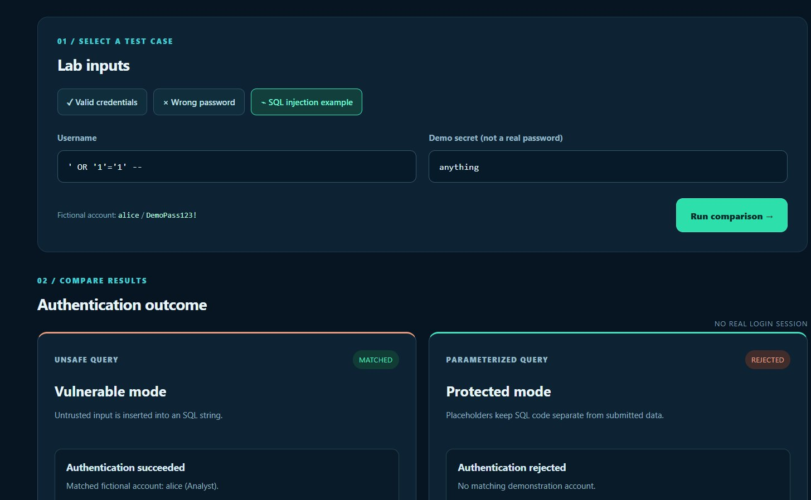
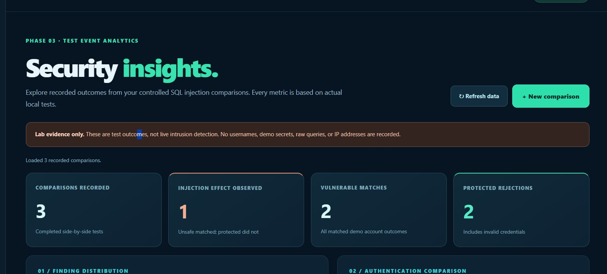
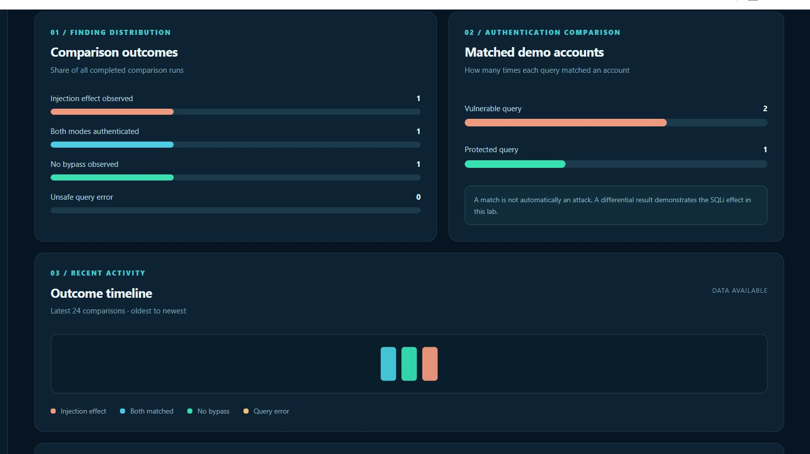
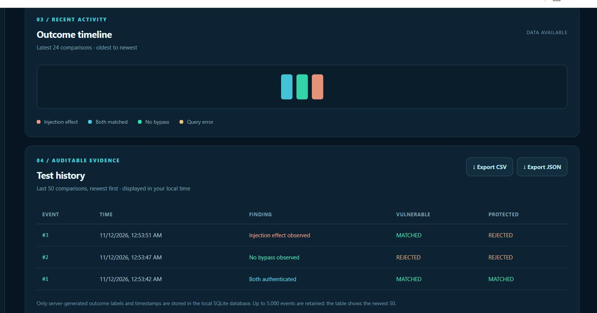
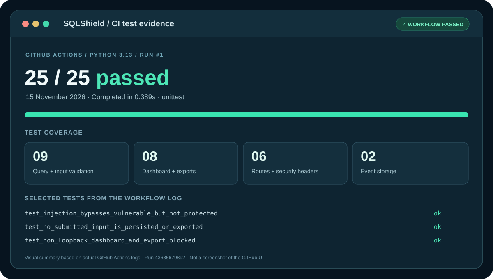

<div align="center">

# SQLShield

### SQL Injection Demonstration & Defence Lab

**Python · Flask · SQLite · Secure Coding · Web Security**

*A controlled, local-only security lab demonstrating SQL injection, secure query construction and evidence-based testing.*

[](https://github.com/TanjidIslamTanim/sqlshield-sqli-lab/actions/workflows/python-tests.yml)   

[Project case study](portfolio/index.html) · [Architecture](docs/architecture.md) · [Threat model](docs/threat-model.md) · [Security boundaries](SECURITY.md)

</div>

---

## Overview

SQLShield was developed for **System Security coursework at University of Wollongong Malaysia**. It compares two ways of handling the same database input: an intentionally unsafe SQL query and a protected query that uses SQLite parameter binding.

The lab uses fictional accounts and a local Flask interface. A separate dashboard records sanitized outcomes, charts and test history. It is designed for **learning and demonstration**, not production authentication.

> [!IMPORTANT]
> The vulnerable code is deliberately insecure. **Never deploy the Flask backend publicly, expose it through a tunnel or test it against real accounts.** Only the static [`portfolio/`](portfolio/) case-study website is intended for public hosting, after confirming that publishing the coursework is permitted.

## Application preview

*Original capture from the running SQLShield local lab, not a mockup.*



## Feature gallery

Actual screenshots captured from the local application. Click any image to inspect it.

<table>
  <tr>
    <td width="50%"><a href="portfolio/assets/evidence/lab.jpg"></a><br><strong>01 · SQL injection comparison</strong><br><sub>Run the same input through both SQL query paths.</sub></td>
    <td width="50%"><a href="portfolio/assets/evidence/dashboard.jpg"></a><br><strong>02 · Security dashboard</strong><br><sub>Review recorded outcomes and summary metrics.</sub></td>
  </tr>
  <tr>
    <td><a href="portfolio/assets/evidence/charts.jpg"></a><br><strong>03 · Outcome charts</strong><br><sub>Visualize query matches and observed injection effects.</sub></td>
    <td><a href="portfolio/assets/evidence/history.jpg"></a><br><strong>04 · Test history and exports</strong><br><sub>Inspect timestamped, sanitized events and export options.</sub></td>
  </tr>
</table>

### Automated testing evidence

The repository's first GitHub Actions run completed successfully on **15 November 2026**: **25 tests passed** in **0.389 seconds**. Coverage includes authentication comparison, SQL injection handling, input validation, event storage, dashboard statistics, CSV/JSON exports, route behaviour and local-access restrictions.

[](https://github.com/TanjidIslamTanim/sqlshield-sqli-lab/actions/runs/43685679892)

[View the original GitHub Actions run and test logs](https://github.com/TanjidIslamTanim/sqlshield-sqli-lab/actions/runs/43685679892) · [Review the test cases](tests/) · [Read the test plan](docs/test-plan.md)

*The graphic is a visual summary of real CI logs, not a screenshot of GitHub's interface. A passing test suite supports the tested behaviours; it does not certify production security.*

## What it demonstrates

| Component | Implementation | Why it matters |
| --- | --- | --- |
| Unsafe SQL branch | Direct string interpolation | Shows how untrusted input can change SQL structure |
| Protected SQL branch | SQLite `?` placeholders | Keeps input values separate from SQL instructions |
| Comparison interface | Flask + HTML/CSS/JavaScript | Displays both query outcomes side by side |
| Evidence dashboard | Sanitized local event records | Shows comparison totals, outcomes and history |
| Local test suite | Python `unittest` | Checks expected behaviour without a public target |

### Observed Windows-local demonstration

| Test input | Vulnerable query | Protected query |
| --- | --- | --- |
| Valid fictional credentials | Matched | Matched |
| Incorrect demo secret | Rejected | Rejected |
| SQL injection example | **Matched** | **Rejected** |

**Dashboard after three comparisons:** 3 recorded comparisons · 1 injection effect observed · 2 vulnerable matches · 2 protected rejections.

A **match** means the query returned a fictional database row; no real authentication session was created. These are local Windows observations, not verified virtual-machine results.

## Core defence

The protected branch in [`lab/auth.py`](lab/auth.py) uses a fixed SQL statement with bound parameters:

```python
sql = (
    "SELECT username, role FROM demo_users "
    "WHERE username = ? AND demo_secret = ? LIMIT 1"
)
row = conn.execute(sql, (username, demo_secret)).fetchone()
```

This prevents the submitted values from becoming SQL syntax. See the [architecture notes](docs/architecture.md) and [security limitations](docs/limitations.md) for more detail.

## Run locally

**Requirements:** Python 3.10+ and pip. The project uses Flask 3.x and SQLite via the Python standard library.

**Windows PowerShell**

```powershell
py -3 -m venv .venv
.\.venv\Scripts\python.exe -m pip install -r requirements.txt
.\.venv\Scripts\python.exe -m unittest discover -s tests -v
.\.venv\Scripts\python.exe -m lab.app
```

**macOS / Linux**

```bash
python3 -m venv .venv
.venv/bin/python -m pip install -r requirements.txt
.venv/bin/python -m unittest discover -s tests -v
.venv/bin/python -m lab.app
```

Open `http://127.0.0.1:5000/lab` for comparisons or `http://127.0.0.1:5000/dashboard` for recorded outcomes. The server binds to loopback; do not change that binding or enable a public tunnel. Stop it with `Ctrl+C`.

## Repository structure

```text
SQLShield/
├── lab/                    Local-only Flask comparison lab
├── tests/                  Python unittest cases
├── portfolio/              Static case-study website + real screenshots
├── docs/                   Architecture, threat model and limitations
├── .github/workflows/      Automated tests; manual static Pages deployment
├── requirements.txt
├── README.md
└── SECURITY.md
```

## Scope and status

- **Completed locally:** Flask comparison interface, two query implementations, fictional SQLite accounts, dashboard and the three documented Windows test cases.
- **Verified by GitHub Actions:** 25 automated tests passed, including checks for CSV/JSON export content and sanitized event storage ([workflow run](https://github.com/TanjidIslamTanim/sqlshield-sqli-lab/actions/runs/43685679892)).
- **Still pending:** documented virtual-machine demonstration and confirmation that publishing the coursework is permitted.
- **Not included:** real user authentication sessions, production password hashing, a public vulnerable server or production intrusion detection.

Demo secrets are fictional and stored in clear text to isolate the query behaviour. This must not be copied into a real authentication system.

## Author and project context

**Developed and documented by [Tanjid Islam Tanim](https://github.com/TanjidIslamTanim)**, Software Engineering student (Computer Security specialization), University of Wollongong Malaysia.

Created for System Security coursework. The repository documents the implemented features, verified tests and known limitations.

## Publishing and reuse

The repository should remain **private** until the university's coursework-sharing rules and any applicable ownership requirements are checked. The [`portfolio/`](portfolio/) website is static and can later be deployed through GitHub Pages using the [publishing guide](docs/GITHUB_PAGES.md). The workflow is manual to avoid accidental deployment.

No open-source license is granted at this stage. Confirm that you have the necessary rights before adding one.