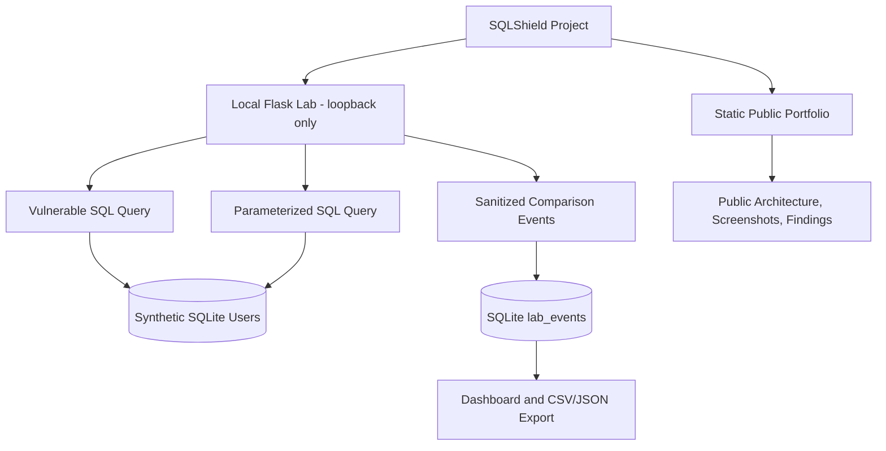

# SQLShield Architecture — Phase 3

The local lab accepts only requests from loopback and binds to `127.0.0.1`. No port forwarding, tunneling or public hosting is permitted. The public portfolio is static and has no backend or vulnerable SQL endpoint.

## Data flow

1. A user submits **fictional** test inputs to `/api/compare`.
2. Flask evaluates the same inputs against unsafe and parameterized SQL queries.
3. The API responds with sanitized outcomes and a finding label; no real session is created.
4. `lab/events.py` records only UTC time and server-generated outcome enums, never submitted values.
5. The dashboard reads aggregate statistics and the latest events; export endpoints produce sanitized CSV/JSON.

## Components

| File | Purpose |
|---|---|
| `lab/auth.py` | Vulnerable and parameterized SQL query implementations |
| `lab/db.py` | Synthetic user schema and seed data |
| `lab/events.py` | Outcome-only event persistence and aggregation |
| `lab/app.py` | Local Flask routes, validation and headers |
| `lab/templates/dashboard.html` | Evidence dashboard |
| `lab/static/js/dashboard.js` | Charts, recent history and refresh |
| `tests/` | Automated tests |
| `portfolio/` | Public static project showcase only |
