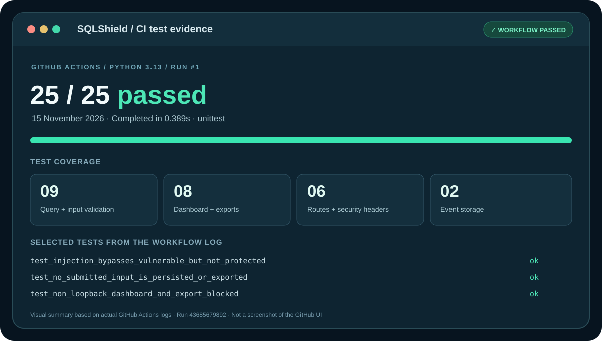

# SQLShield Test Plan — Phase 3

Run from the project root:

```powershell
.\.venv\Scripts\python.exe -m unittest discover -s tests -v
```

## Verified automated test run

The GitHub Actions `Python tests` workflow completed successfully on **15 November 2026**:

- **25 tests passed** in **0.389 seconds** using Python 3.13.
- Coverage: 9 query and validation tests, 8 dashboard/export tests, 6 route/security tests and 2 event-storage tests.
- The suite includes checks for sanitized CSV/JSON exports, local-access restrictions and the different outcomes of vulnerable versus parameterized queries.

[Inspect the original workflow run and logs](https://github.com/TanjidIslamTanim/sqlshield-sqli-lab/actions/runs/43685679892)



This is an automated test result, not proof of a full penetration test or VM demonstration. The visual is a rendered summary of the original logs, not a screenshot of GitHub's UI.

## Functional checks

1. Valid demo credentials: both modes match; dashboard logs `both_authenticated`.
2. Wrong demo secret: both modes reject; dashboard logs `no_bypass_observed`.
3. Controlled SQLi example: vulnerable matches and protected rejects; dashboard logs `injection_effect_observed`.
4. Malformed SQL input: unsafe query returns sanitized query error.
5. Dashboard totals match recorded comparisons, including across server restarts.
6. CSV/JSON exports contain only event IDs, UTC timestamps and outcome labels.
7. No submitted username or secret is stored in `lab_events` or exports.
8. Invalid API requests do not create event records.
9. Non-loopback requests to dashboard, stats and exports are rejected.
10. Confirm `portfolio/` remains the only publicly deployed directory.

## Presentation evidence

Capture real screenshots of the comparison page and dashboard after running tests. Record expected vs actual results and explain that protected rejections include wrong credentials; they are not a count of attacks blocked. Only run this intentionally vulnerable lab on localhost or an isolated VM.
